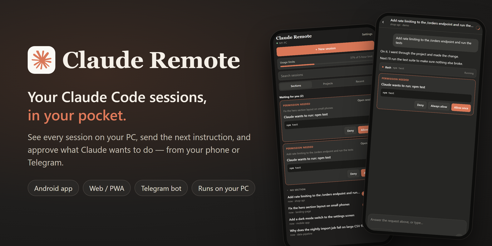
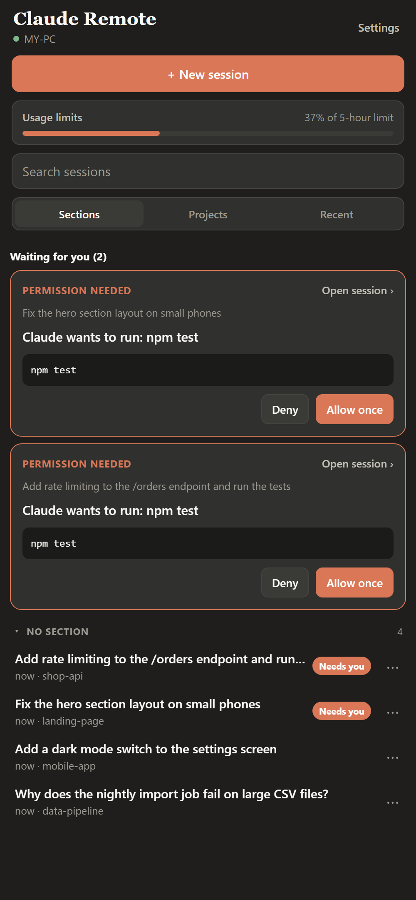
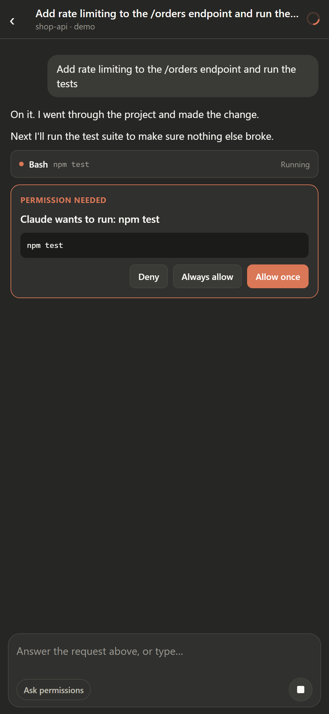
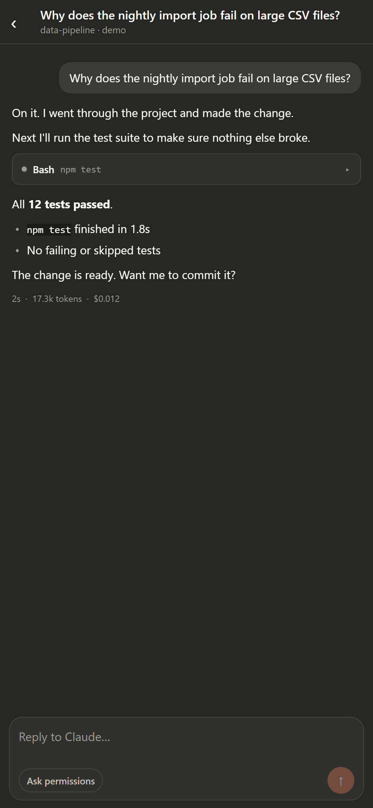
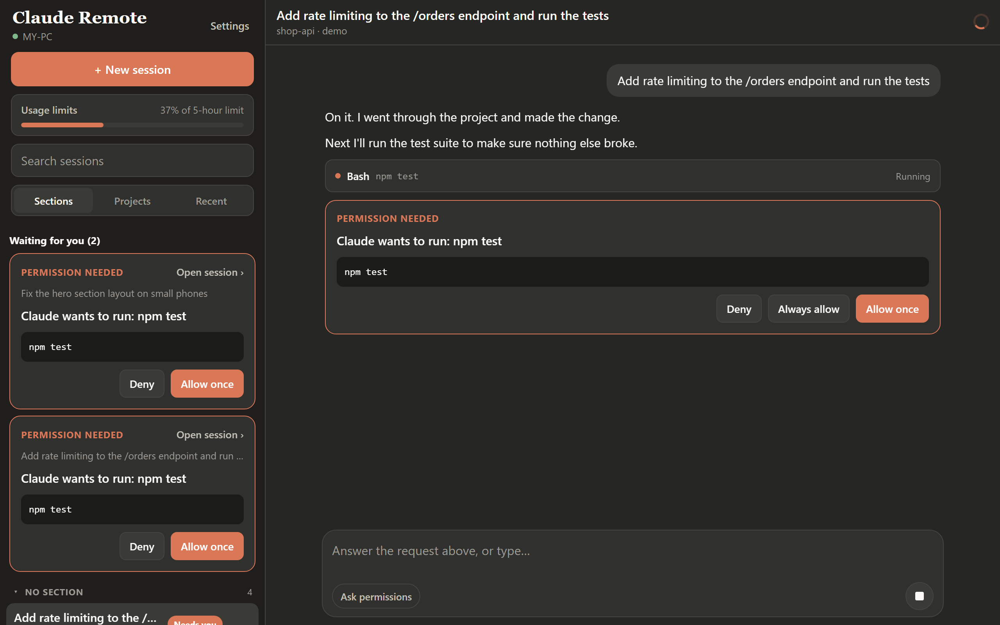

<p align="center">
  
</p>

<p align="center">
  <a href="LICENSE"></a>
  
  
</p>

# Claude Remote

**Your Claude Code, in your pocket.** Keep working with the Claude Code sessions on your own computer from your phone, a browser, or Telegram: read the conversation, send the next instruction, and approve what Claude wants to do — while you are away from your desk.

> Unofficial, community project. Not made by or affiliated with Anthropic. "Claude" is a trademark of Anthropic.

```
   📱 Phone app / browser ──┐                                         ┌──► your Claude Code sessions
                            ├──►  Claude Remote service on your PC ───┤
   ✈️  Telegram bot ─────────┘     (a small background service)       └──► permission prompts from the
                                                                            Claude desktop app
```

## Why

You start a long task in Claude Code, walk away, and come back to find it stopped twenty minutes ago on *"Allow this command?"*. Claude Remote sends that question to your phone, so the work keeps moving:

- **Approve or deny from anywhere.** Permission prompts and Claude's multiple-choice questions arrive on your phone and in Telegram with Allow / Deny buttons. Your answer is applied on the PC.
- **Including the desktop app.** Prompts from sessions running in the Claude desktop app or a terminal are forwarded too (through a Claude Code hook). Answer on the computer instead and the phone and Telegram are told: *"✅ Allowed on the computer"*.
- **All your sessions, organised.** See every session on the PC, grouped by the same sections as the desktop app's sidebar. Continue any of them, start new ones in any folder, rename, archive, stop.
- **Your usage at a glance.** Plan limits and reset times, like the desktop app shows them.
- **Nothing gets lost.** Requests wait on the PC until someone answers. Offline for an hour? When you reconnect you see what is still waiting, and nothing you already answered.

## See it

<p align="center">
  
  &nbsp;
  
  &nbsp;
  
</p>
<p align="center"><sub>Waiting requests on top of every session · approve from the chat · the result, with tokens and cost</sub></p>

<p align="center">
  
</p>
<p align="center"><sub>The web app on a wide screen. Screenshots from the built-in demo mode.</sub></p>

## What you get

| Client | Best for |
|---|---|
| **Android app** (React Native) | Day-to-day use: chat, sessions, notifications with Allow / Deny buttons, waiting count on the icon |
| **Web app / PWA** | Any phone or browser on your network; installable, responsive (phone and desktop layouts) |
| **Telegram bot** | Reaching you anywhere: nothing to open on your network, works through a proxy |

All clients talk to one small service on your PC. Every client sees the same sessions and the same waiting requests; whichever one answers first wins.

## How it works

The service runs on your computer (Windows, Linux or macOS) as your user and drives Claude Code through the official Claude Agent SDK. It works with the same sessions Claude Code already stores on the PC, so nothing moves to a third-party server: your code, files and conversations stay on your machine. The phone talks to the service over your network (or Tailscale); the Telegram bot only makes outbound requests.

For sessions you run in the Claude desktop app, a Claude Code hook hands each permission prompt to the service and waits for a remote answer. If nobody answers in time, or the service is off, Claude simply shows its normal prompt on the computer.

## Quick start

Works on **Windows, Linux and macOS**. You need [Node.js](https://nodejs.org) 20+ and Claude Code installed and signed in (`claude`, then `/login`).

```bash
git clone https://github.com/alirezasariri78/claude-remote.git
cd claude-remote
```

| | Install | Runs as |
|---|---|---|
| **Windows** | PowerShell as Administrator: `powershell -ExecutionPolicy Bypass -File .\install.ps1` | Windows services |
| **Linux** | `./install.sh` (as your user, not sudo) | systemd user services |
| **macOS** | `./install.sh` | launchd agents |

The installer asks a few questions (an optional proxy, whether to forward desktop-app prompts, the firewall), installs the packages, builds the web app, and starts two background services that run as you, so they see your Claude sign-in and sessions. At the end it prints the address to open on your phone; the access token is in `server/bridge-config.json`.

**Then connect a client:**

- **Phone browser:** open `http://<computer address>:8091` and enter the token. Install it from the browser menu to get an app icon.
- **Android app:** install the APK and enter `<computer address>:8787` and the token.
- **Telegram:** create a bot with @BotFather, put its token in `server/bridge-config.json`, restart the service, and follow the bot's reply.

**Update later:** `git pull`, then `.\install.ps1 -KeepServices` (Windows) or `./install.sh --update` (Linux, macOS). Your settings are kept.

**Just trying it?** Run the service in a terminal in demo mode, with simulated replies and no usage spent: `cd server && npm install`, then `BRIDGE_DEMO=1 npm start` (on Windows PowerShell: `$env:BRIDGE_DEMO=1; npm start`).

**[docs/INSTALL.md](docs/INSTALL.md)** has step-by-step instructions for each system, updating, logs and troubleshooting. **[docs/SETUP.md](docs/SETUP.md)** is the full reference: the desktop-app hook, the PWA, the Telegram bot, and adding your own client.

## Security

Whoever has the address and token can run commands on your computer as you. Treat the token like a password.

- Keep the service on your own network, or reach it through a VPN such as Tailscale. **Never forward the port to the internet.**
- The phone connection is plain `ws://`; on networks you do not control, use a VPN or a TLS reverse proxy.
- The Telegram bot only answers the user ids you list, and never acts in groups.

## Claude Remote or Claude's own Remote Control?

Claude Code has a built-in [Remote Control](https://code.claude.com/docs/en/remote-control) that continues a session from the Claude mobile app. They solve different problems, and you can use both:

| | Claude's Remote Control | Claude Remote |
|---|---|---|
| **Which sessions** | The ones you enable (or all new ones, with auto-connect) | Every session on the PC, in one list |
| **Same live session as the desktop window** | Yes, mirrored live | Continues the same saved session, but does not mirror the open window |
| **Start new sessions from the phone** | No | Yes, in any folder on the PC |
| **Organise sessions** | No | Sections, rename, archive, stop, delete |
| **Approve permissions** | For connected sessions | For its own sessions, and for desktop-app sessions through the hook |
| **Usage limits** | No | Yes |
| **Telegram** | No | Yes |
| **Reaching the PC from outside** | Anywhere, through Anthropic's servers | Same network or a VPN; Telegram works anywhere |
| **Behind a company proxy** | May be blocked or disconnect | Works through the proxy |
| **Security** | Managed by Anthropic, no ports opened | Yours to manage: the token, and keeping the port off the internet |
| **Notifications when the app is closed** | Push notifications | Telegram; the Android app while it runs in the background |
| **Setup** | Built in | Install the service yourself |
| **Plans** | Pro, Max, Team, Enterprise (claude.ai sign-in) | Any working Claude Code sign-in |

**Remote Control** is the better choice when your network allows it and you want to follow the exact session that is open on your desktop, with nothing to install. **Claude Remote** gives you more control over the whole PC (every session, new sessions, sections, usage, desktop-app approvals) and reaches you through Telegram even where Remote Control cannot connect.

## Project layout

| Folder | What it is |
|---|---|
| `server/` | The service: `core.mjs` (sessions, permissions), `transports/` (WebSocket, Telegram), `hook/` (desktop-app permission hook) |
| `mobile/` | The Expo / React Native app (Android and web) |
| `mobile/service/` | Small static server that hosts the web app as a background service |
| `docs/` | Setup guide and reference |

Adding another client (Slack, Discord, a CLI…) is one file in `server/transports/`; see [docs/SETUP.md](docs/SETUP.md#adding-another-client).

## Status

Built and tested on Windows 11. The Linux and macOS installer is new: if something does not work on your system, please open an issue. Pull requests are welcome.
